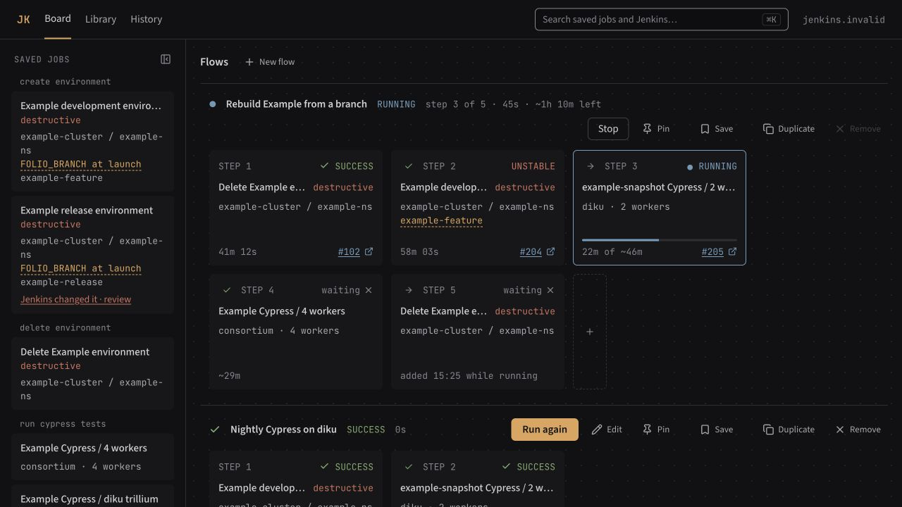

# JK -- a local web panel for FOLIO Jenkins jobs

JK is a web panel that runs on your own computer. In the Library you save the
values for a Jenkins job once; on the Board you put saved jobs into flows, review
exactly what each step will send, and watch the builds run. History keeps every
flow that has started.

JK talks to `https://jenkins.ci.folio.org` over its REST API. It submits a saved
step at most once and keeps local run state in SQLite.



## Quick start

You need Docker with Compose v2 and an account on
[FOLIO Jenkins](https://jenkins.ci.folio.org) with permission to run your jobs.
Create an API token in your Jenkins account settings at
<https://jenkins.ci.folio.org/me/configure>.

```sh
git clone https://github.com/yauhen-vavilkin/jk.git
cd jk
cp .env.example .env
chmod 600 .env
```

Open `.env` in your editor and replace the user ID and token placeholders with
your own credentials. Then start the panel:

```sh
docker compose up -d
```

Open <http://127.0.0.1:8765>, add a job in **Library**, then put it into a flow
on **Board**. Review the job, environment and parameter values before **Run**.
Stop the panel with `docker compose down`; saved jobs and history stay in the
Docker volume.

The screenshot uses offline fixtures, not a live Jenkins session.

## Status and limits

JK is an early version for **FOLIO Jenkins**. Compatibility with other Jenkins
controllers is not tested or supported. The panel is intended for one trusted
user on their own computer; keep its port bound to `127.0.0.1`.

- Job values, including passwords, are stored as typed in the local SQLite
  database and are visible in the panel. There is no encryption or masking.
  State files are owner-only; this does not protect them from your own account
  or administrators. Keep backups private too.
- JK submits each step at most once. A connection failure can still leave the
  result uncertain; resolve it against Jenkins before starting another flow.
- Automated tests use mocked Jenkins responses. Real-controller submission,
  queue handling and restart behavior still need human verification; see
  [the validation gap](spec.md#15-known-validation-gap).
- Defect status is tracked in [known bugs](docs/KNOWN_BUGS.md).

Use a current desktop browser. The frontend requires Safari 16.4+, Chrome 111+
or Firefox 128+. For source development, use macOS or Linux, Python 3.14,
[uv](https://docs.astral.sh/uv/), and Node.js 22.12+ with npm. Windows users can
run the Docker version.

## Configure

The ignored `.env` at the root of the checkout contains only:

```sh
JENKINS_URL=https://jenkins.ci.folio.org
JENKINS_USER_ID=your-jenkins-user-id
JENKINS_API_TOKEN=your-api-token
```

JK reads credentials from this file; the process environment wins over it.
Docker Compose passes its variables into the container (`env_file` in
`compose.yaml`), so the token never enters the image. To change the token, edit
`.env` and run `docker compose up -d`; `docker compose restart` does not read
`.env` again. Never put a Jenkins token in job parameters, history, logs, or
documentation. Keep `.env` readable only by its owner (`chmod 600 .env`).

## The Web Panel

- **Library** stores jobs and their parameter values.
- **Board** reviews and runs flows of saved jobs.
- **History** keeps flows that have started and their build links.

<details>
<summary>Detailed panel reference</summary>

The panel has three pages:

- **Board** -- saved jobs on the left, parallel *flows* in the middle, on the
  dot grid. Flows stand in the order they were made, the pinned ones first. The
  button beside **SAVED JOBS** hides the left column and shows it again; a
  saved flow's row there reads its steps and Jenkins' guess for them, as in
  `6 steps · ~42m`.

  A flow on the board is one of two things, and **Edit** moves between them; it
  reads **Done** while you are editing. The flow says **EDITING** then: steps can
  be added, reordered and removed, its name can be changed, and **Run** waits.
  After **Done** it says **READY**: it runs, and nothing about it changes by
  accident. A flow dragged in from **Saved flows** arrives ready, because it was
  built once already.

  **New flow**, beside the **Flows** heading, opens a short list of saved jobs
  and saved flows with a search field, and starts a flow from the one you pick.
  The **+** at the end of a flow opens the same list and adds the pick as its
  last step. Dragging does the same: a saved job dropped on a card of a flow
  that says **EDITING** goes before that card on its left half and after it on
  its right half, and anywhere else on a flow it goes at the end. Steps inside
  a flow run in the order shown, and flows run beside each other. A flow accepts
  a new step while it is running. The icon before **STEP N** says when that step
  starts, and changes it; by default a failed step ends the flow. A step not yet
  sent is moved by dragging it, or with **Move to step N** in the details its
  card opens, and removed only by its **×**: let go outside its flow, it goes
  back where it was. Once a flow has finished or failed, its steps stay as they
  ran.

  Once a flow has ended it is a record: **Run again** creates a fresh copy and
  opens its review. The previous run stays on the Board until the copy starts
  successfully. A failed review sends nothing. **Cancel** removes the copy; if
  JK is offline, reconnect and cancel again. After a reload, the READY copy can
  be reviewed or deleted normally; remove the original from the Board separately. **Edit** -- or a saved job dropped on an ended
  flow -- replaces it with a copy to be changed first. **Duplicate** makes a
  second flow with the same steps
  under a free name. **Save** writes the flow's steps -- the jobs, in order, with
  their conditions and the values typed for them -- into **Saved flows**, so a
  flow taken from it later starts with those values filled in. It lights up while
  the flow differs from the saved flow it is kept as, reads **Saving…** on the
  way, and **Saved** once there is nothing left to save; a flow never saved shows
  a plain **Save**. The flow's name is not part of it: the saved flow keeps the
  name its own row gives it, so nothing you do on the board ever renames it.
  A flow with a value still empty cannot start: its header reads **NOT READY**,
  and **Fill N values** stands where **Run** will be. It opens the first step
  with a value still empty, as **step 2 of 6**; a value an earlier step already
  has comes filled in, marked **From step 1**. Once every one is filled it turns
  into **Run**. A step whose saved job Jenkins has changed carries a **Jenkins
  changed it · review** link; its flow reads **NOT READY** too, and **Review N
  jobs** opens the saved job in the Library. **Remove** takes the flow off the
  board and leaves what is kept where it is: a flow that ran stays in History,
  and a draft, which never ran, is deleted. Either way a line above the board
  offers **Undo** for a few seconds. The pin keeps a flow at the top. The `~` times are
  Jenkins' guess, from how long each job last took.

  Two flows on the board never share a name, and neither do two saved flows. A
  run that ended still counts while it is shown; once **Remove** clears it off --
  or JK does, by itself, 12 hours after it finished or failed, unless it is
  pinned -- its name is free again. Where you type the name, a taken one is refused; where
  the panel names a flow itself -- a duplicate, or a saved flow dropped in a
  second time -- it takes `Name copy`, then `Name copy 2`.
- **Library** -- every parameterised job on the controller, in its Jenkins
  folders, with what you saved for a job listed under it and a **+** beside the
  job to save another set of values for it. A saved job appears under Saved jobs:
  `fixed` is sent as written, `at launch` is typed per run -- in the window a
  card's **Fill N values** opens, or in the review, which names any still empty
  -- and `default` leaves the parameter to its Jenkins default and sends nothing
  for it. When Jenkins changes a job, the saved job is marked and does not run
  until you have looked at the change: set the new parameters in the table and
  press **Accept as shown**, which saves them. **Used by** names each flow and
  step that uses the saved job, so you know where a Save lands. **Save** reads
  **Saved** when the saved job holds what is shown, and what you have changed
  but not saved stays on screen if the saved job is changed elsewhere meanwhile
  -- in another tab, say. Leaving the editor with unsaved changes asks
  **Discard changes to <name>?** first.
- **History** -- every flow that has started, active and finished; a draft that
  never ran is only on the Board. A row opens in place with the run's steps as
  on the Board, read-only, and a step shows the values it sent. A row not from
  today carries its date. **Open on the board** leads to a flow still there,
  and **Run again** opens the review of a fresh copy on the Board.

Your values live in `.jk/runs.db`, not in files. A saved job is made only in
the Library. The trash button beside **Save** removes a saved job that no flow
is using; while one is, the button is off. A saved flow is renamed, duplicated
and deleted from its own row in the Saved flows column: rest the pointer on the
row and the three appear beside its steps and time.

Nothing is sent that you have not reviewed. **Run** on a draft opens a review
that shows exactly what each step will send. A job you add to a flow that has already
started opens **Review added step N**: **Confirm step N** lets it run when the
flow gets there, and **Remove step N** takes it off. Left unconfirmed, it waits,
marked *needs review*, until you open **Review added steps**. **Resume** opens
the same review first.

When JK cannot tell if Jenkins started a step, the flow says **NEEDS ATTENTION**
and **Resolve step N** stands beside **Stop**, or in place of **Resume** once it
is stopped. It lists the builds that match what JK sent: link one and the flow
goes on (a stopped one waits for **Resume**), or **End flow**: the flow reads
**ENDED** and the step **not linked**. Until then the flow cannot be removed.

The one Jenkins write the panel adds is the second of the two buttons **Stop**
opens: **Abort #N and stop**, or **Cancel queued build and stop** while queued.
**Stop after #N**, or **Stop flow** while queued, sends nothing; `spec.md`
sections 7, 9 and 11 have the rules.

</details>

## Run it in Docker

The image carries Python, the dependencies and the built frontend, so the
machine that runs it needs only Docker.

`compose.yaml` sets `pull_policy: build`, so every `up` rebuilds the image from
the checkout and replaces the container when anything changed; unchanged layers
come from the cache. Run `docker compose up -d` again after pulling or editing
code. Stop it with `docker compose down`.

Without Compose, the same thing is:

```sh
docker build -t jk-panel .
docker run -d --name jk-panel -p 127.0.0.1:8765:8765 -v jk-data:/app/.jk --env-file .env jk-panel
```

`docker run --env-file` takes every value literally, quotes included, so the
`.env` it reads must hold its values without quotes, as `.env.example` does.

What to know:

- **Your data** lives in the Docker volume `jk-data`, not in the checkout's
  `.jk/`. It survives `docker compose down` and a rebuilt image;
  `docker volume rm jk-data` deletes it for good. The container and a panel run
  straight from the checkout (see "Run from source") keep separate
  histories.
- **File ownership:** the container runs as UID 1000. Its state directory is
  `0700` and its files are `0600`. Existing state owned by this user is hardened
  on startup without changing its contents. A bind mount or custom `--user`
  needs a state directory owned by that UID; JK does not change file ownership.
- **Only this computer** can open the panel: the port is published on
  `127.0.0.1`. Keep it that way; the panel can start Jenkins builds.
- **Another computer** needs no checkout. Save the image with
  `docker save jk-panel | gzip > jk-panel.tar.gz`, load it there with
  `docker load < jk-panel.tar.gz`, and run the `docker run` line with the path
  to that computer's `.env`. An image built on Apple silicon runs on Apple
  silicon; for an Intel Mac or Linux PC, build with
  `docker buildx build --platform linux/amd64 --load -t jk-panel .`.
- A missing `.env` stops `docker compose up` with an error.

## Run from source

Without Docker, the panel runs straight from the checkout and keeps its state in
the checkout's `.jk/`. Configure `.env` as described above, then run:

```sh
make bootstrap
(cd web && npm run build)
uv run --locked --offline jk serve
```

`jk serve` opens `http://127.0.0.1:8765` in a browser. `--port` moves it,
`--no-open` leaves the browser alone. `jk` with no command prints its usage and
exits with code 2. To see frontend changes as you make them, run these in
separate terminals:

```sh
uv run --locked --offline jk serve --dev
cd web && npm run dev      # Vite on 5173, proxying /api
```

To look at the panel without a controller, on fixture data (`make fixtures` runs
the same command):

```sh
uv run --locked --offline python -m tests.fixture_server --port 8799 --dist web/dist
```

## Development

Install [uv](https://docs.astral.sh/uv/getting-started/installation/), Node.js
22.12+ with npm, and Make. From a fresh checkout, bootstrap installs Python
and both dependency sets from `uv.lock` and `web/package-lock.json`:

```sh
make bootstrap
make check
```

The default test suite is offline. The root pytest configuration installs a
process-local TCP boundary before test modules are imported for collection:
Python calls through `socket.socket.connect` and `connect_ex` are rejected in
the pytest process. This boundary does not control arbitrary child processes;
subprocess-based tests must select their own offline mode or install their own
process guard.

```sh
uv run --locked --offline pytest -q
uv run --locked --offline ruff check .
uv run --locked --offline ruff format --check .
git diff --check
cd web && npm run typecheck && npm test && npm run build
```

`make check` runs all of it without changing the lockfiles. It uses uv's default
cache and offline mode after bootstrap; no personal cache configuration is needed.
Format changed Python files before the gate with
`uv run --locked --offline ruff format <files>`.

### GitHub CI

[Check](.github/workflows/check.yml) runs `make bootstrap` in a separate step, then
`make check` for pushes to `main` and pull requests. It needs no Jenkins secrets
and does not run the opt-in live contract tests. Actions are pinned by commit SHA
and receive read-only repository permission.

### Live contract tests

The opt-in contract suite runs only with `JK_CONTRACT=1`, which also lifts the
TCP boundary. It talks to the real controller through `ReadOnlyTransport`, which
permits only `GET`; it starts with `GET /me/api/json`, then reads job definitions
and build metadata. It never submits, replays, cancels, or approves a build:

```sh
JK_CONTRACT=1 uv run --locked pytest tests/contract -m contract -q
```

## Documents

`spec.md` is the single specification: the product contract and the accepted
technical decisions. This README only explains how to install and run JK;
`AGENTS.md` says which document owns what.

## Contributing

Check [known bugs](docs/KNOWN_BUGS.md) before opening an issue. Include the JK
version or commit, browser, steps to reproduce and the expected result. Remove
tokens, passwords and private job values from logs and screenshots.

For changes, follow [the specification](spec.md) and
[UI design rules](design/UI_DESIGN.md), add focused regression coverage where
behavior changes, and run `make check` before submitting a pull request. Keep
Jenkins writes out of automated tests.

## License

JK code is licensed under [MIT](LICENSE), copyright 2026 Yauhen Vavilkin.
The bundled fonts retain their own SIL Open Font License 1.1:
[JetBrains Mono](web/public/fonts/JetBrainsMono-LICENSE.txt) and
[Source Sans 3](web/public/fonts/SourceSans3-LICENSE.txt).

Font copyright and version metadata are preserved in the bundled WOFF2 files.
Their upstream projects are [JetBrains Mono](https://github.com/JetBrains/JetBrainsMono)
and [Source Sans](https://github.com/adobe-fonts/source-sans). Both font licenses
are copied into the frontend build and Docker image under `fonts/`. Helvetica,
Arial and SFMono-Regular are system fallbacks, not bundled resources.

The build also includes `THIRD_PARTY_NOTICES.txt` with the licenses of frontend
dependencies, including Lucide icons (ISC and the included Feather MIT notice).
The README screenshot is generated from JK’s offline example data.
